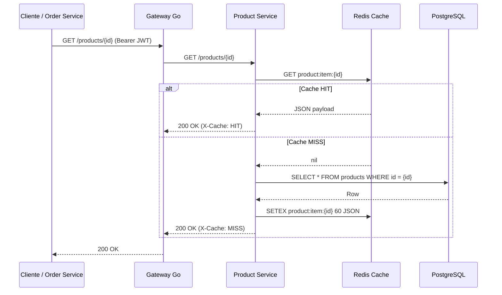
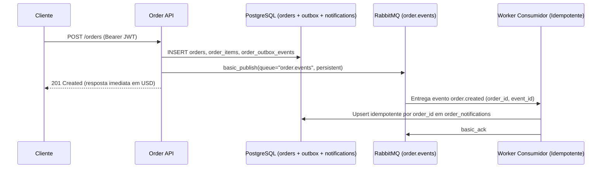

# Gargalos da Pessoa B: Cache Redis (B1) e Mensageria RabbitMQ (B2)

Conforme o roteiro oficial de divisão em dupla, a **Pessoa B** é responsável pela implementação, instrumentação e comprovação experimental de dois tratamentos de gargalos arquiteturais nos microsserviços de negócio:

1. **Tratamento B1 — Cache Redis (`Cache-Aside`) no `Product Service`**
2. **Tratamento B2 — Mensageria Assíncrona e Idempotência com RabbitMQ no `Order Service`**

---

## 1. Tratamento B1: Cache Redis no Product Service (`store-product`)

### Problema de Arquitetura
Em um e-commerce, a leitura de catálogo (`GET /products`) e de detalhes de produtos (`GET /products/{id}`) ocorre em frequência muito superior à escrita, além de `GET /products/{id}` ser chamado sincronicamente pelo `Order Service` a cada item de cada pedido criado. Sem cache, toda leitura atinge o PostgreSQL, elevando a latência de cauda (`p95`/`p99`) e disputando conexões com transações de escrita (`POST /orders`, `POST /accounts`).

### Solução Implementada
Implementamos o padrão **Cache-Aside** usando **Redis 7** no `store-product`:
- **Chaves de Cache**:
  - Detalhe de produto: `product:item:<uuid>`
  - Listagem e busca: `product:list:<filtro_normalizado>`
- **Fluxo de Leitura (`GET /products` e `GET /products/{id}`)**:
  1. Consulta a chave no Redis. Se encontrada, retorna imediatamente com cabeçalho `X-Cache: HIT` e incrementa `product_cache_events_total{operation="detail|list", result="hit"}`.
  2. Se ausente (`X-Cache: MISS`), consulta o PostgreSQL, serializa o resultado no Redis com `EX = CACHE_TTL_SECONDS` (padrão `60s`) e retorna a resposta.
  3. Suporta cabeçalho de controle `X-Cache-Control: no-cache` (`X-Cache: BYPASS`) para permitir comparação controlada A/B no mesmo ambiente sem desligar o Redis.
- **Política de Expiração e Invalidação em Escrita/Remoção**:
  - Em `POST /products`: invalida imediatamente todas as chaves `product:list:*` para que o novo produto apareça nas listagens sem esperar o TTL.
  - Em `DELETE /products/{id}`: remove o registro no PostgreSQL e invalida imediatamente `product:item:<id>` e `product:list:*`. Uma leitura subsequente retorna `404 Not Found` imediatamente, evitando leitura stale.
  - Caso o Redis fique indisponível, o serviço degrada graciosamente para leitura direta no PostgreSQL (`X-Cache: BYPASS`) sem derrubar a API.



### Como Reproduzir o Experimento B1
```bash
python3 tests/cache_bottleneck.py --users 8 --requests-per-phase 240 --output artifacts/cache-bottleneck.json
```
O script valida:
1. Primeira leitura (`X-Cache: MISS`) seguida de segunda leitura (`X-Cache: HIT`);
2. Invalidação imediata após `DELETE /products/{id}` (`204` -> `404`);
3. Benchmark comparativo de vazão (`req/s`) e latência (`avg`, `p50`, `p95`, `p99`) com e sem cache para `GET /products/{id}` e `GET /products`.

---

## 2. Tratamento B2: Mensageria Assíncrona com RabbitMQ no Order Service (`store-order`)

### Problema de Arquitetura
Quando um pedido é criado (`POST /orders`), tarefas posteriores como geração de notificações ao cliente, auditoria de eventos e integrações de backoffice não devem bloquear a resposta HTTP do checkout nem causar falha da compra caso o processador de notificações esteja temporariamente lento ou indisponível.

### Solução Implementada
Implementamos desacoplamento assíncrono com **Transactional Outbox + RabbitMQ 3 + Consumidor Idempotente**:
- **Publicação Confiável (Outbox + Fila Durável)**:
  - Ao criar um pedido em `POST /orders`, o `Order Service` persiste na mesma transação do banco o pedido (`orders`), seus itens (`order_items`) e o evento `order.created` na tabela `order_outbox_events` (`status="PENDING"`).
  - Em seguida, publica a mensagem com `delivery_mode=2` (persistente) na fila durável `order.events` do RabbitMQ (configurada com Dead-Letter Queue `order.events.dlq`) e marca o evento no outbox como `PUBLISHED`. Se o broker estiver momentaneamente indisponível no instante do `POST`, a thread de background republica automaticamente os eventos `PENDING` assim que a conexão AMQP é restabelecida.
- **Consumo Assíncrono com Controle de Resiliência**:
  - O worker consumidor lê mensagens da fila `order.events` com `basic_qos(prefetch_count=10)` e confirmação explícita (`basic_ack` após persistência, ou `basic_nack` em falha).
  - O endpoint operacional `POST /orders/events/consumer` (`{"enabled": false|true}`) permite simular a queda/pausa do worker de notificações enquanto novos pedidos continuam sendo criados normalmente com baixa latência.
- **Garantia de Idempotência**:
  - A tabela `order_notifications` possui restrição `UNIQUE (order_id)` no PostgreSQL.
  - Quando um mesmo evento `order.created` é entregue mais de uma vez (at-least-once delivery ou via `POST /orders/{id}/events/replay`), o consumidor detecta o registro existente para aquele `order_id`, incrementa apenas o contador `delivery_attempts` e confirma a mensagem (`ACK`) **sem duplicar a notificação**.



### Como Reproduzir o Experimento B2
```bash
python3 tests/messaging_bottleneck.py --batch-size 12 --output artifacts/messaging-bottleneck.json
```
O script comprova:
1. Com o consumidor pausado (`consumer_enabled: false`), 12 chamadas `POST /orders` respondem `201 Created` rapidamente enquanto as mensagens ficam retidas com segurança;
2. Ao reativar o consumidor (`consumer_enabled: true`), todas as 12 notificações acumuladas são drenadas e processadas em milissegundos;
3. Ao republicar 2 vezes o evento de um pedido já processado (`POST /orders/{id}/events/replay`), a contagem de linhas em `GET /orders/{id}/notifications` permanece igual a `1`, enquanto `delivery_attempts` sobe para `3`, provando idempotência.
