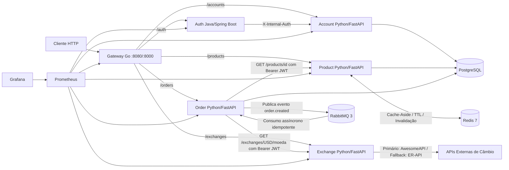

# Microserv Store — Pessoa B

Projeto em dupla da disciplina **Platforms, Microservices, DevOps and APIs (2026.2 — Insper)**, com entrega até **16/11/2026**.

- **Pessoa A**: **Yuri Henrique** (`uyrisne@gmail.com`) — `store-account` (Python/FastAPI), `store-auth` (Java/Spring Boot), `store-gateway` (Go), observabilidade (Prometheus/Grafana) e balanceamento/HPA base. Documentação: [store-docs-a](https://microserv-1.github.io/store-docs-a/).
- **Pessoa B**: **Gustavo Lima Affonso Ferreira** (`gustavolaf@al.insper.edu.br`, GitHub `@gustavolafz`) — `store-product` (Python/FastAPI + Cache Redis), `store-order` (Python/FastAPI + Mensageria RabbitMQ), `store-exchange` (Python/FastAPI obrigatório + provedores externos de câmbio com fallback), integração ponta a ponta no `store-root`, testes de gargalos e carga, e documentação da Pessoa B (`store-docs-b`).

## Escopo e arquitetura completa (6 microsserviços integrados)

A plataforma implementa um backend de e-commerce distribuído em 6 microsserviços independentes, todos expostos exclusivamente através do **API Gateway em Go** e autenticados via **JWT HS256**:

## Repositórios e autoria

| Entrega | Responsável | Repositório |
|---|---|---|
| Repositório integrador (Compose, K8s, Scripts, Submódulos) | Dupla (A + B) | [Microserv-1/store-root](https://github.com/Microserv-1/store-root) |
| Microsserviço de Contas (`Account`) | Pessoa A | [Microserv-1/store-account](https://github.com/Microserv-1/store-account) |
| Microsserviço de Autenticação (`Auth`) | Pessoa A | [Microserv-1/store-auth](https://github.com/Microserv-1/store-auth) |
| API Gateway (`Gateway`) | Pessoa A | [Microserv-1/store-gateway](https://github.com/Microserv-1/store-gateway) |
| Microsserviço de Produtos + Cache Redis (`Product`) | **Pessoa B** | [Microserv-1/store-product](https://github.com/Microserv-1/store-product) |
| Microsserviço de Pedidos + RabbitMQ (`Order`) | **Pessoa B** | [Microserv-1/store-order](https://github.com/Microserv-1/store-order) |
| Microsserviço de Câmbio em Python (`Exchange`) | **Pessoa B** | [Microserv-1/store-exchange](https://github.com/Microserv-1/store-exchange) |
| Documentação Pessoa A | Pessoa A | [Microserv-1/store-docs-a](https://github.com/Microserv-1/store-docs-a) |
| Documentação Pessoa B | **Pessoa B** | [Microserv-1/store-docs-b](https://github.com/Microserv-1/store-docs-b) |

> [!IMPORTANT]
> Os 6 microsserviços são mantidos em repositórios independentes na organização `Microserv-1` e integrados como **Git submodules** em `store-root/api/*`, garantindo versionamento isolado, `Dockerfile`, `Jenkinsfile` e `k8s/k8s.yaml` próprios por serviço.
